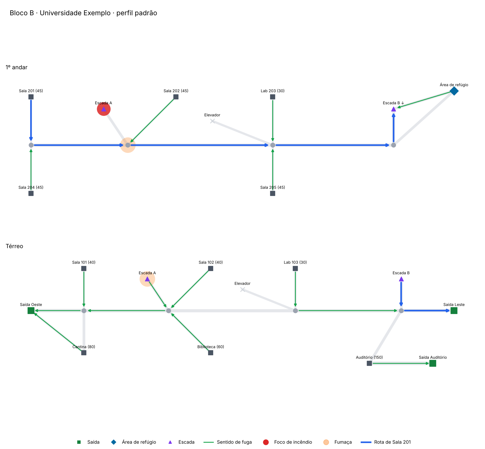
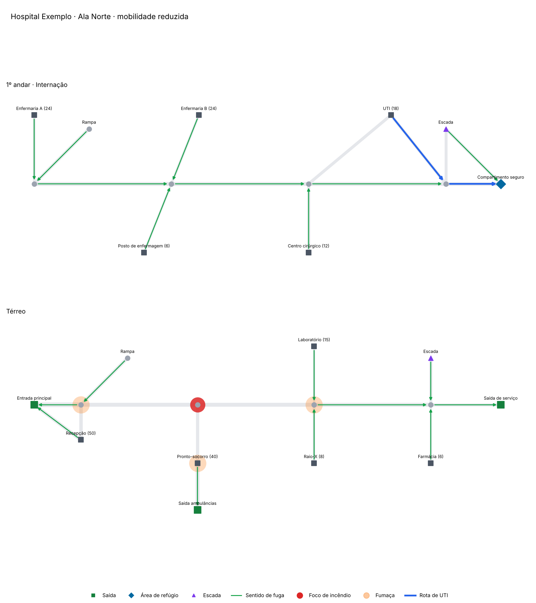
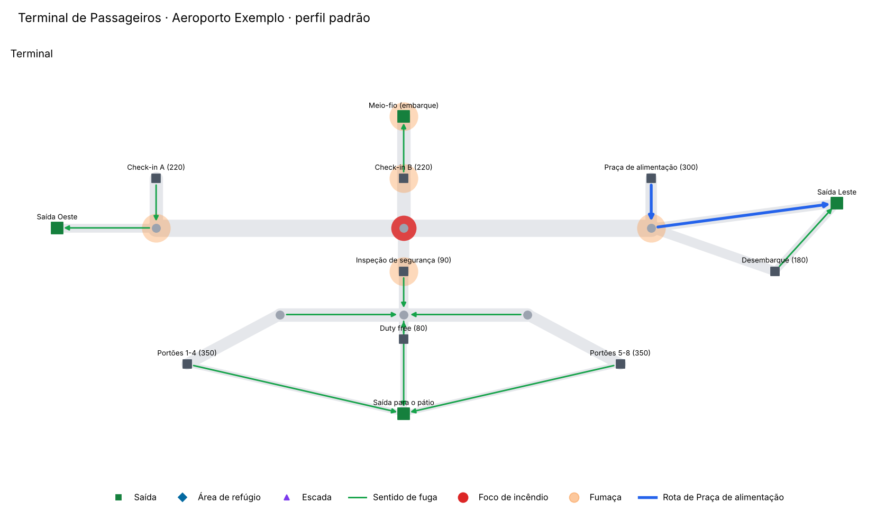

# Rota Segura

Mapeamento de rotas de fuga em caso de incêndio para qualquer edificação: universidades, hospitais, aeroportos, shoppings, escolas. Você descreve a planta em YAML, informa onde está o fogo e o sistema devolve a melhor rota de cada ambiente, o tempo estimado de evacuação, o gargalo do prédio e um mapa com as setas de fuga.



No exemplo acima a Escada A do 1º andar pegou fogo. Os alunos da Sala 201 deixam de descer por ela e seguem pelo corredor até a Escada B. O corredor ao lado do foco recebe penalidade de fumaça e o sistema avisa que a rota passa por ali.

## O que o sistema faz

| Recurso | Como funciona |
|---|---|
| Rota mais rápida | Dijkstra multi-origem partindo de todas as saídas de uma vez. Uma passada resolve o prédio inteiro. |
| Cenário de incêndio | Nós com fogo saem do grafo. Vizinhos recebem penalidade de fumaça (custo x3, configurável). |
| Mobilidade reduzida | Perfil que ignora escadas e elevadores e aceita rampas e áreas de refúgio como destino. |
| Tempo de evacuação | Modelo hidráulico: pré-movimento + deslocamento + fila na porta (1,3 pessoa/m/s). |
| Validação do projeto | Ambientes sem saída, percurso acima do limite, portas abaixo de 0,80 m, saída única. |
| Resiliência | Bloqueia cada saída, uma de cada vez, e mostra quantas pessoas ficam presas. |
| Mapa | PNG por andar com setas de fuga, foco, fumaça e rota destacada. |
| API REST | FastAPI com documentação automática em `/docs`. |

## Instalação

```bash
git clone https://github.com/SEU_USUARIO/rota-segura.git
cd rota-segura
python -m venv .venv && source .venv/bin/activate
pip install -e ".[dev,api]"
pytest
```

Requer Python 3.10 ou superior.

## Uso pela linha de comando

```bash
# Rota de uma sala, com fogo na Escada A
rotasegura rota exemplos/universidade.yaml --origem s201 --fogo escA_1
# s201 -> c11 -> c12 -> c13 -> c14 -> escB_1 -> escB_T -> cT4 -> saida_leste
# Destino: saida_leste | 54.0 m | 1min06s
# Aviso: a melhor rota disponível atravessa área com fumaça.

# Mesma sala, cadeirante: vai para a área de refúgio e aguarda resgate
rotasegura rota exemplos/universidade.yaml --origem s201 --perfil mobilidade_reduzida
# s201 -> c11 -> c12 -> c13 -> c14 -> refugio_1

# Tempo total de evacuação e gargalo
rotasegura evacuacao exemplos/universidade.yaml

# Mapa com rota destacada
rotasegura mapa exemplos/hospital.yaml --fogo hT2 --perfil mobilidade_reduzida --origem uti -o mapa.png

# Verificações do projeto e simulação de perda de cada saída
rotasegura validar exemplos/hospital.yaml
rotasegura resiliencia exemplos/aeroporto.yaml
```

Saída de `evacuacao` para a universidade:

```
Bloco B · Universidade Exemplo | 610 ocupantes | pré-movimento 1min00s
saída                  pessoas  pess/s      fila   término
saida_aud                  150     3.1       48s   1min53s
saida_leste                105     2.9       26s   2min02s
saida_oeste                355     4.4       44s   2min26s
Tempo total estimado: 2min26s
Gargalo: saida_oeste
```

A Saída Oeste recebe 355 pessoas e vira o gargalo. Alargar essa porta ou redistribuir a ocupação é o primeiro ajuste que o relatório sugere.

## Uso pela API

```bash
uvicorn rotasegura.api:app --reload
# abra http://localhost:8000/docs
```

| Método | Rota | Retorno |
|---|---|---|
| GET | `/edificios` | Edifícios disponíveis na pasta `exemplos/` |
| GET | `/edificios/{id}/rota?origem=s101&fogo=cT2` | Caminho, distância e tempo |
| POST | `/edificios/{id}/plano` | Rotas de todos os ambientes e tempo de evacuação |
| GET | `/edificios/{id}/mapa.png?fogo=hall2&origem=praca_alim` | Imagem do mapa |
| GET | `/edificios/{id}/validacao` | Erros e alertas do projeto |
| POST | `/plano` | Mesmo cálculo para um edifício enviado no corpo |

Para servir outra pasta de edifícios, defina `ROTASEGURA_EDIFICIOS=/caminho/da/pasta`.

```bash
curl -X POST localhost:8000/edificios/hospital/plano \
  -H "Content-Type: application/json" \
  -d '{"fogo": ["hT2"], "perfil": "mobilidade_reduzida"}'
```

## Uso como biblioteca

```python
from rotasegura import Cenario, Edificio, Perfil, calcular_plano, estimar_evacuacao

ed = Edificio.de_yaml("exemplos/aeroporto.yaml")
plano = calcular_plano(ed, Cenario(bloqueados={"hall2"}))

print(plano.rota("praca_alim").caminho)
print(estimar_evacuacao(plano).tempo_total_s)
```

## Como descrever um edifício

Cada ambiente vira um nó com coordenadas em metros. Cada porta, trecho de corredor ou lance de escada vira uma conexão.

```yaml
nome: Minha Escola
tipo: escola
distancia_maxima: 40          # limite de percurso até a saída, em metros

andares:
  - {id: T, nome: Térreo, elevacao: 0}

nos:
  - {id: sala1, andar: T, tipo: sala, x: 0, y: 5, nome: Sala 1, ocupacao: 35}
  - {id: corr,  andar: T, tipo: corredor, x: 0, y: 0}
  - {id: porta, andar: T, tipo: saida, x: 10, y: 0, nome: Portão}

conexoes:
  - {de: sala1, para: corr, largura: 0.9}
  - {de: corr,  para: porta, largura: 2.0, tipo: porta_corta_fogo}
```

Tipos de nó: `sala`, `corredor`, `escada`, `elevador`, `saida`, `area_refugio`.
Tipos de conexão: `horizontal` (padrão), `escada`, `rampa`, `porta_corta_fogo`.

A distância de cada conexão é calculada pelas coordenadas. Em escadas e rampas informe `distancia` com o comprimento percorrido. Elevadores ficam fora de qualquer rota, como manda a sinalização de emergência.

## Exemplos incluídos

| Arquivo | Ocupantes | O que demonstra |
|---|---|---|
| `universidade.yaml` | 610 | Dois andares, duas escadas, auditório com saída própria, área de refúgio |
| `hospital.yaml` | 203 | Rampa acessível, compartimento seguro para evacuação horizontal da UTI |
| `aeroporto.yaml` | 1.790 | Quatro saídas, píer de embarque, gargalo na saída para o pátio |





## Modelo de cálculo

O custo de cada trecho é tempo de caminhada: distância dividida pela velocidade do tipo de conexão (1,2 m/s em plano, 1,0 m/s em rampa, 0,6 m/s em escada). Trechos com fumaça têm o tempo multiplicado pela penalidade.

O Dijkstra parte de todas as saídas ao mesmo tempo sobre o grafo não direcionado. Ao terminar, cada nó guarda o tempo até a saída mais próxima e o próximo passo da rota. Recalcular para um novo foco de incêndio custa O((V + E) log V), rápido o bastante para rodar a cada leitura de sensor.

O tempo de evacuação soma o pré-movimento (padrão 60 s), o deslocamento e a fila em cada saída, que escoa 1,3 pessoa por metro de largura por segundo. Os grupos entram na fila em ordem de chegada.

## Limitações

Este projeto é uma ferramenta de estudo e apoio ao planejamento. Ele não substitui o Projeto de Prevenção e Combate a Incêndio (PPCI), a NBR 9077 nem as Instruções Técnicas do Corpo de Bombeiros do seu estado.

O modelo trata cada ambiente como um ponto, não simula contrafluxo nem a capacidade de escadas e corredores intermediários, e a fumaça se espalha por regra fixa em vez de simulação de dinâmica de fluidos.

## Próximos passos

- Importar plantas de arquivos IFC/BIM e DXF
- Capacidade de fluxo em escadas e corredores, não só nas saídas
- Leitura de detectores de fumaça via MQTT para recalcular rotas em tempo real
- Painel web com a planta interativa
- Simulação por agentes para comparar com o modelo hidráulico

## Licença

MIT. Veja [LICENSE](LICENSE).
